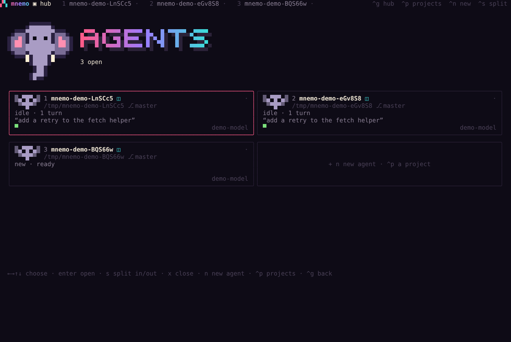

<p align="center"></p>

# Mnemo

[](https://github.com/AtmanMishra/Mnemo/actions/workflows/ci.yml)
[](LICENSE)

**A terminal coding agent with a memory that learns your projects.** Several
agents in one window, a pixel interface, and your choice of model. Open source,
pre-alpha.



After each run Mnemo writes down what it learned about the project and about
you, recalls it in the next session, keeps the fix when something failed, and
writes skills for itself. The bet: a small, cheap model with accumulated memory
goes further than the same model without it.

## Install

macOS and Linux:

```bash
curl -fsSL https://github.com/AtmanMishra/Mnemo/releases/latest/download/install.sh | sh
```

Windows (PowerShell):

```powershell
irm https://github.com/AtmanMishra/Mnemo/releases/latest/download/install.ps1 | iex
```

The same scripts are served from the project site, which is shorter to type:

```bash
curl -fsSL https://mnemo.atmanmishra.dev/install.sh | sh
```

```powershell
irm https://mnemo.atmanmishra.dev/install.ps1 | iex
```

Or, on Windows, download `mnemo-windows-x64.zip` from
[the download page](https://mnemo.atmanmishra.dev/download), unzip it, and
double-click `mnemo.exe`: it offers to install itself to
`%USERPROFILE%\.mnemo\bin` and add that to your PATH (`mnemo install --yes`
does the same from a script). Then open a new terminal and type `mnemo`.

No Bun, Node or Rust is needed: the installer downloads one archive holding
`mnemo` and its memory sidecar `memsrv`, checks its SHA-256, and puts both in
`~/.mnemo/bin`. On a terminal it draws itself as it goes; piped or with
`NO_COLOR` it prints plain lines. `sh -s -- --version v0.1.2` (or
`MNEMO_VERSION=v0.1.2`, also on Windows) installs a specific release. Read the
script first if you like: [`app/scripts/get.sh`](app/scripts/get.sh). More on
[the download page](https://mnemo.atmanmishra.dev/download).

Then:

```bash
mnemo doctor     # what it found: model, memory, python (--fix repairs what it can)
mnemo --demo     # a scripted session in a scratch project; needs no API key
mnemo            # start in this folder
```

On first run, `/login` adds a provider key and `/model` picks a model. Mnemo also
uses credentials it finds in your environment (`ANTHROPIC_API_KEY`,
`OPENAI_API_KEY`, `OPENCODE_API_KEY`, `AWS_*` and others): see
[SECURITY.md](SECURITY.md).

### Updating

```bash
mnemo update            # install the latest release (checks its SHA-256 first)
mnemo update --check    # only say whether there is one
mnemo update --auto on  # a daily check at launch that tells you; never installs on its own
```

Inside Mnemo, `/update` does the same. Homebrew and Scoop installs update with
`brew upgrade mnemo` / `scoop update mnemo`. The daily check is off by default:
until you turn it on, Mnemo never contacts anything but your model provider.

### Settings

`/settings` opens a menu of everything you can tune: the theme and layout, the keys, the agent
limits (message chain, sub-agent counts, the woken-turn budget), notifications, Python cell time
and more. `/settings hops 20` changes one setting in a sentence and `mnemo settings` does the same
from a shell. Defaults are what Mnemo always did; choices are kept in `~/.mnemo/config.json`.
The full list is [docs/SETTINGS.md](docs/SETTINGS.md).

### Uninstalling

```bash
mnemo uninstall           # remove the program; memory, sessions and settings stay
mnemo uninstall --deep    # also delete ~/.mnemo: memory, sessions, credentials, skills, logs
```

It lists what it will remove and asks first (`--deep` wants you to type
`delete`; `--yes` skips the question in scripts). The install scripts do the
same without Mnemo:

```bash
curl -fsSL https://mnemo.atmanmishra.dev/install.sh | sh -s -- --uninstall   # or --deep
```

```powershell
$env:MNEMO_UNINSTALL="1"; irm https://mnemo.atmanmishra.dev/install.ps1 | iex      # or "deep"
```

`--deep` only deletes a folder that holds nothing but what Mnemo put there;
otherwise it says so, keeps the folder and exits non-zero. If
you attached memory to Claude Code or Codex (`mnemo memory setup`), remove the
`mnemo` entries from their settings too.

<details><summary>From source</summary>

Needs [Bun](https://bun.sh) 1.3+ and a Rust toolchain.

```bash
git clone https://github.com/AtmanMishra/Mnemo && cd Mnemo
bun install
(cd memory-layer && cargo build --release --bin memsrv)
cd app && bun bin/mnemo.ts --demo
```

`app/scripts/install.sh` builds the binary and installs it from this checkout.
</details>

## What it does

- **Remembers.** Facts, conventions, pitfalls with their fixes, open threads and
  skills, stored locally. `/memory` shows them, `/forget` retires one, and the
  memory map (`m` in the memory pane) draws them. In the memory pane, `e`
  edits a fact, `d` forgets it, and `+`/`-` tell recall what helped and what was
  wrong: recall ranks by those votes, and what was marked wrong twice is no
  longer recalled. `mnemo memory tidy` finds duplicates, facts about files that are gone
  and what was marked wrong (`--apply` retires them). Search can use your own
  embedding server: `MNEMO_EMBED_URL=http://localhost:11434/v1/embeddings
  MNEMO_EMBED_MODEL=nomic-embed-text` (Ollama).
- **Reads your project's instructions.** `AGENTS.md` (or `CLAUDE.md` where a
  folder has no `AGENTS.md`) in the project and every folder above it, plus
  `$MNEMO_HOME/agent/AGENTS.md` for all projects, go into the system prompt.
- **MCP servers as tools.** Put servers in `$MNEMO_HOME/agent/mcp.json` (or a
  trusted project's `.agents/mcp.json`) in the `mcpServers` shape other clients use; stdio
  and HTTP servers both work (an HTTP one only with `"allowNetwork": true` in your own
  file), and `/mcp` lists them, signs in and reconnects. Their
  tools stay out of the prompt until `tool_search` finds them (`"exposure": "direct"`
  declares them up front). In `default` mode each call asks first; "always" covers that tool.
  A stdio server gets only the safe basics and its own `env`, not your tokens.
- **Memory for other agents.** `mnemo memory setup claude-code` prints the hooks
  and MCP entry that give Claude Code (or Codex) the same memory; `mnemo memory
  ingest` learns from Claude Code sessions you already have.
- **Many agents, one window.** `ctrl+g` the hub, `ctrl+s` split view (up to
  four, in several layouts with `alt+l`), `ctrl+p` switch project, `ctrl+n`
  another agent on this project.
- **Agents that work in teams.** An agent can start sub-agents, and they can start
  their own; the hub draws the tree. Link two agents as siblings (`l` in the hub)
  and they can see and message each other, and a sub-agent can reach its parent's
  siblings; links come back when both projects are open again. In a split you can
  type to a running sub-agent. `ctrl+y` is the playground, a read-only view of them
  all at work, with each pair's conversation as a thread (`c`).
- **Keyboard first.** `ctrl+k` on an empty prompt goes to any command, agent,
  session or file; `ctrl+f` finds in the conversation; `/stats` shows the
  session and the week; `ctrl+o` expands output that is already printed; file
  paths and links are clickable; a long turn that ends while you are in another
  window sends a desktop notification. Every screen fits the terminal, at any
  size. All commands and keys: [docs](https://mnemo.atmanmishra.dev/docs),
  [shortcuts](https://mnemo.atmanmishra.dev/shortcuts).
- **Checks its work.** A run that changed code and ran nothing is sent back to
  run the project's checks. `--escalate provider/id` finishes a run on a stronger
  model after two failed checks; `mnemo -p "<task>" --best-of 3 --check "npm
  test"` races three attempts in separate worktrees and applies the smallest
  change that passes (`/bestof` does the same from the interface).
- **Rewinds.** `esc esc` on an empty prompt (or `/rewind`) goes back to before
  an earlier message: the conversation, the files the agent edited since, or
  both, and your message returns to the prompt. In a git repository, what shell
  commands and Python cells changed goes back too (files git ignores do not).
- **Stays out of your keys.** Commands the agent runs (bash, the Python kernel)
  get an allowlisted environment: no model-provider key, `GITHUB_TOKEN`,
  `NPM_TOKEN` or `AWS_*` (the `passEnv` setting hands one back), and the Python kernel has a timeout and a memory cap; see
  [SECURITY.md](SECURITY.md).
- **A pixel interface** with Mne the elephant, eleven themes (`/theme`) and a
  sidebar for files, memory, sessions, skills and logs. The spec is
  [DESIGN.md](DESIGN.md).

## Does the memory help?

Measured on a small model (DeepSeek v4.1 Flash), the same loop with memory on
and off. Small samples; the write-ups say what went wrong along the way.

| Test | No memory | Memory |
|---|---|---|
| six tasks in one repo, with rules the code does not reveal (3 runs) | 87% | 100% |
| two repos whose rules conflict (2 runs) | 82% | 99% |
| Terminal-Bench subset: 10 easy/medium tasks, one attempt each | 10/10 | 10/10 |

The last row is the honest one: unrelated one-off tasks give memory nothing to
remember. It is a subset run on our own machine, not comparable to the public
leaderboard. Details, and a comparison with a Hermes-style memory:
[research/](research/), [research/hermes-comparison.md](research/hermes-comparison.md),
[research/terminal-bench-2026-10-08.md](research/terminal-bench-2026-10-08.md).

## Before you run it

Mnemo reads your files, edits them and runs commands as you. It asks before
every edit and command by default. `/accept-edits` stops it asking about
edits, `/yolo` (or `--yolo`) about everything, and headless `-p` never asks, so
use the last two in a container or a throwaway checkout. The gate filters
what runs; it is not a sandbox. Your prompts and the files the model reads go to
the provider you chose; nothing else leaves your machine, and there is no
telemetry, and no update check unless you turn one on. Read
[SECURITY.md](SECURITY.md), which also says how to report a vulnerability
([also on the website](https://mnemo.atmanmishra.dev/security)).

## Repository

| Path | |
|---|---|
| `app/` | the program: Ink interface, agent loop on the [pi](https://github.com/earendil-works/pi) SDK, extensions, evals |
| `packages/memory/` | `@mnemo/memory`: the memory loop any agent can drive |
| `memory-layer/` | `memsrv`, the Rust memory sidecar |
| `web/` | the project site, <https://mnemo.atmanmishra.dev> (Vite + React, prerendered) |
| `site/` | the earlier project page (GitHub Pages) and the images this README uses |
| `docs/` | [ROADMAP](docs/ROADMAP.md), [RELEASING](docs/RELEASING.md), [the previous stack](docs/LEGACY.md) |
| `research/` | the evals and the design papers |
| branch [`legacy`](https://github.com/AtmanMishra/Mnemo/tree/legacy) | the previous stack (`tui-go/`, `agent/`, `harness-engine/`), kept for reference and **unmaintained** |

Contributing: [CONTRIBUTING.md](CONTRIBUTING.md). Maintainers cutting a release:
[docs/RELEASING.md](docs/RELEASING.md).

## Status

Pre-alpha. It works, it has tests, and it has rough edges; file what you find in
[the issue tracker](https://github.com/AtmanMishra/Mnemo/issues). What is left,
in order, is in [docs/ROADMAP.md](docs/ROADMAP.md) and on
[the roadmap page](https://mnemo.atmanmishra.dev/roadmap); what changed in each
release is in [the changelog](https://mnemo.atmanmishra.dev/changelog).

## License

[Apache-2.0](LICENSE). Third-party notices: [NOTICE](NOTICE).
