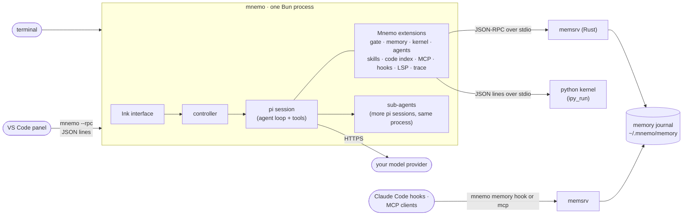
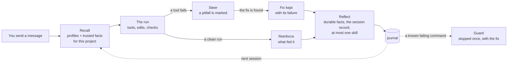
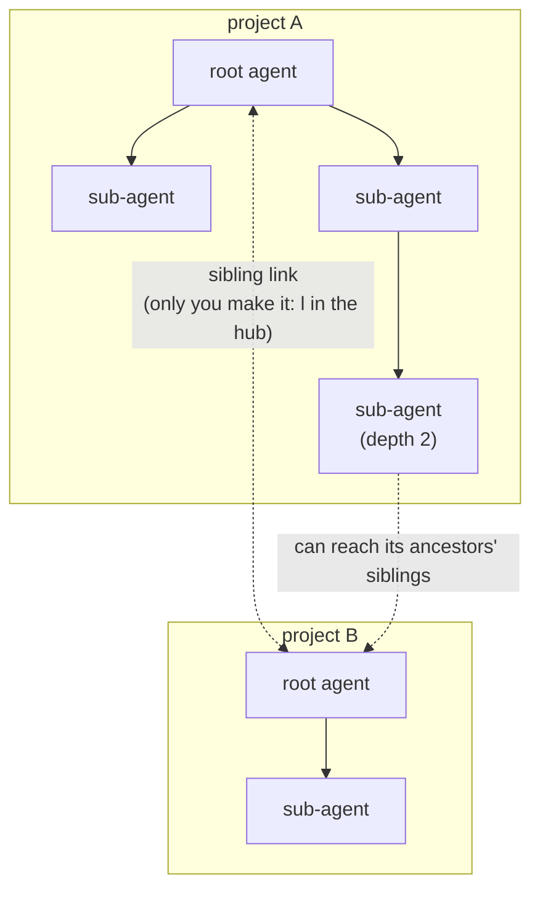
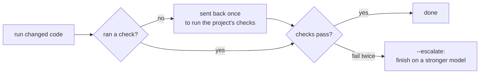
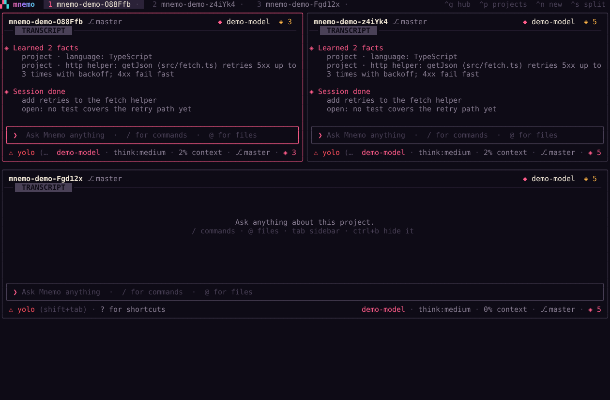
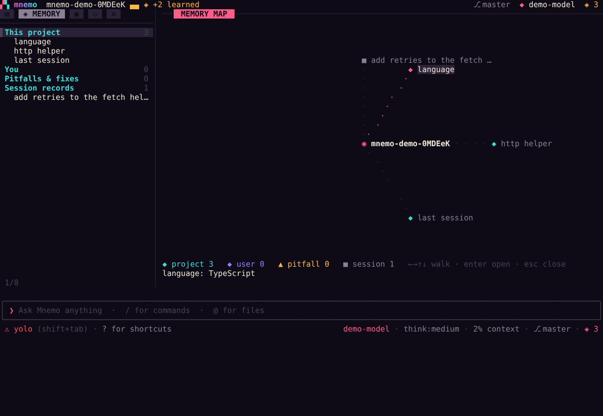
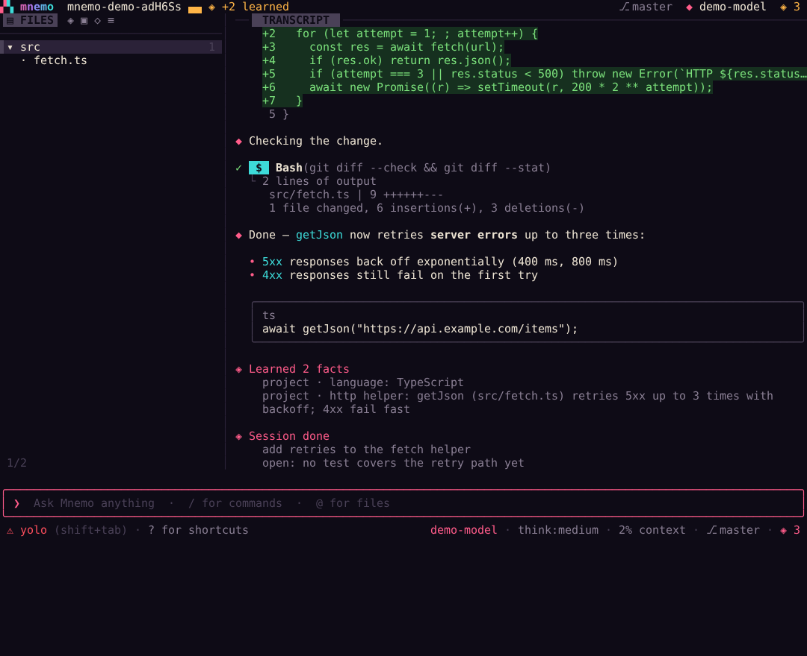
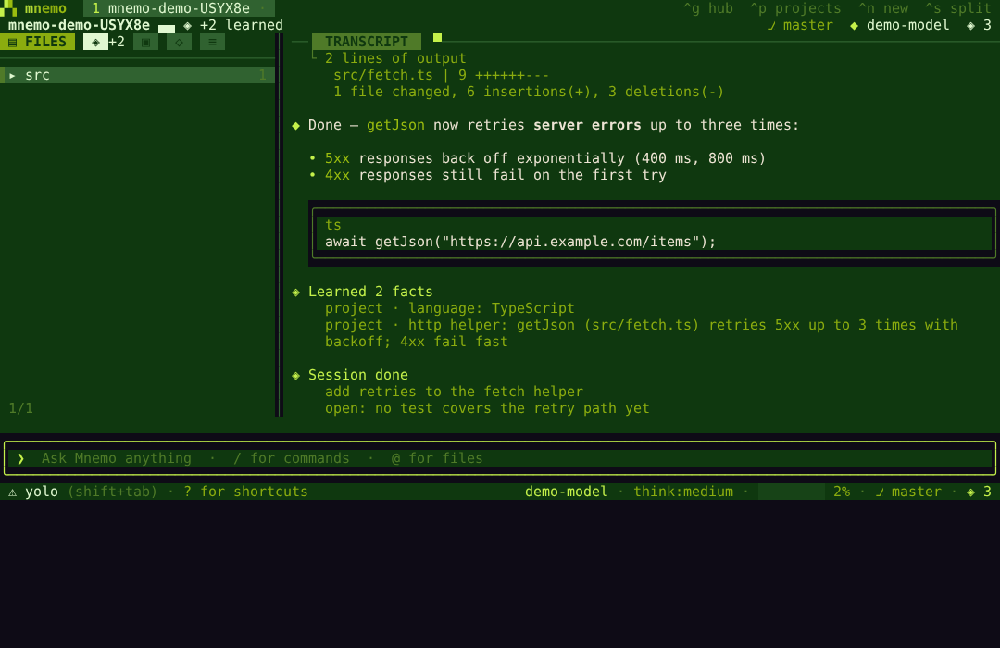
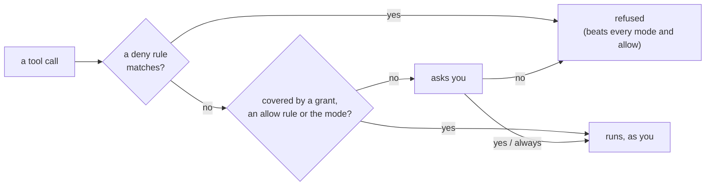

<div align="center">


# Mnemo

**A terminal coding agent with a memory that learns your projects.**

Several agents in one window, a pixel interface, and your choice of model.<br>
Open source, local first, pre-alpha.

[](https://github.com/AtmanMishra/Mnemo/actions/workflows/ci.yml)
[](https://github.com/AtmanMishra/Mnemo/releases/latest)
[](LICENSE)
[](https://mnemo.atmanmishra.dev/download)
[](#status)

[**Website**](https://mnemo.atmanmishra.dev) ·
[**Install**](#install) ·
[**Quick start**](#quick-start) ·
[**How it works**](#how-it-works) ·
[**Security**](#security-model) ·
[**Roadmap**](#roadmap) ·
[**Docs**](https://mnemo.atmanmishra.dev/docs)


</div>

---

## Contents

<table>
<tr>
<td valign="top" width="33%">

**Start**
- [Why Mnemo](#why-mnemo)
- [At a glance](#at-a-glance)
- [Install](#install)
- [Quick start](#quick-start)

</td>
<td valign="top" width="33%">

**Understand**
- [How it works](#how-it-works)
- [Memory](#memory)
- [Agents in teams](#agents-in-teams)
- [Tools the agent has](#tools-the-agent-has)
- [Hooks, schedules, language servers](#hooks-schedules-and-language-servers)
- [Checked work and rewind](#checked-work-and-rewind)
- [The interface](#the-interface)
- [In your editor](#in-your-editor)

</td>
<td valign="top" width="33%">

**Operate**
- [Configuration](#configuration)
- [Security model](#security-model)
- [Does the memory help?](#does-the-memory-help)
- [Roadmap](#roadmap)
- [Repository](#repository)
- [Contributing](#contributing)
- [Status](#status) · [License](#license)

</td>
</tr>
</table>

> [!NOTE]
> Items marked <sup>**`main`**</sup> are merged and tested on the `main` branch but are not yet in a
> downloadable release; the installers fetch the [latest release](https://github.com/AtmanMishra/Mnemo/releases/latest).
> Work still in review is listed under [Roadmap](#roadmap), never as shipped.

---

## Why Mnemo

Most coding agents start every session from nothing. They rediscover your build command, repeat
the mistake they made yesterday and forget the convention you corrected twice. Mnemo writes down
what it learned after each run, about the project and about you, and brings it back the next time.

> **The bet:** a small, cheap model with accumulated memory goes further than the same model
> without it. [The numbers so far](#does-the-memory-help) are small samples, published with their
> method and with what went wrong.

<table>
<tr>
<td valign="top" width="33%">

### 🧠 It remembers
Facts, conventions, pitfalls with their fixes, open threads and skills, in a journal on your
machine. When something fails, the fix is kept and the failing command is stopped next time.
**→ [Memory](#memory)**

</td>
<td valign="top" width="33%">

### 🐘 It works in teams
Many agents in one window: sub-agents that start their own, siblings that message each other,
split panes and a playground to watch them all.
**→ [Agents in teams](#agents-in-teams)**

</td>
<td valign="top" width="33%">

### 🔒 It stays yours
It asks before every edit and command by default. No telemetry; nothing leaves your machine but
what goes to the model provider you chose and the opt-ins you name.
**→ [Security model](#security-model)**

</td>
</tr>
</table>

---

## At a glance

| | Feature | What you get | Read more |
|---|---|---|---|
| 🧠 | **Memory** | Recall before each message, reflection after each run, votes that rank what helped | [Memory](#memory) |
| 🧭 | **Steering** | A command that failed before is stopped once with its known fix | [The loop](#the-memory-loop) |
| 🤝 | **Memory for other agents** | Claude Code (hooks) and Codex, Cursor, opencode (MCP) share the same memory | [Other agents](#memory-for-other-agents) |
| 🌳 | **Agent teams** | Sub-agents to depth 3, sibling links, messages that wake idle agents within a budget | [Agents in teams](#agents-in-teams) |
| 🔌 | **MCP servers** | Their tools found on demand by `tool_search`, every call through the gate | [Tools](#tools-the-agent-has) |
| 🗺️ | **Code index** <sup>**`main`**</sup> | Where something is defined, what calls it, and what an edit affects elsewhere | [Tools](#tools-the-agent-has) |
| 🐍 | **Python kernel** | One long-lived interpreter with a timeout and a memory cap | [Tools](#tools-the-agent-has) |
| 🪝 | **Hooks, schedules, language servers** <sup>**`main`**</sup> | Your commands around tool calls, prompts on a timer, compiler errors after each edit | [Automation](#hooks-schedules-and-language-servers) |
| ✅ | **Checked work** | Runs sent back to run the checks, escalation to a stronger model, best-of-n | [Checked work](#checked-work-and-rewind) |
| ⏪ | **Rewind** | Back to before any message: the conversation, the files, or both | [Rewind](#rewind) |
| 🎨 | **Pixel interface** | Eleven themes, a sidebar, a palette, split views, all keyboard first | [The interface](#the-interface) |
| 🧩 | **VS Code** | A panel with chat, approvals with diffs, agents, memory and settings | [In your editor](#in-your-editor) |
| ⚙️ | **Settings** | One menu for look, behaviour, agent limits, notifications and keys | [Configuration](#configuration) |

---

## Install

No Bun, Node or Rust is needed: the installer downloads one archive holding `mnemo` and its
memory sidecar `memsrv`, checks its SHA-256, and puts both in `~/.mnemo/bin`.

<table>
<tr>
<th>macOS and Linux</th>
<th>Windows (PowerShell)</th>
</tr>
<tr>
<td>

```bash
curl -fsSL https://github.com/AtmanMishra/Mnemo/releases/latest/download/install.sh | sh
```

</td>
<td>

```powershell
irm https://github.com/AtmanMishra/Mnemo/releases/latest/download/install.ps1 | iex
```

</td>
</tr>
<tr>
<td>

The same script from the project site, which is shorter to type:

```bash
curl -fsSL https://mnemo.atmanmishra.dev/install.sh | sh
```

</td>
<td>

The same script from the project site:

```powershell
irm https://mnemo.atmanmishra.dev/install.ps1 | iex
```

</td>
</tr>
</table>

Or, on Windows, download `mnemo-windows-x64.zip` from
[the download page](https://mnemo.atmanmishra.dev/download), unzip it, and
double-click `mnemo.exe`: it offers to install itself to
`%USERPROFILE%\.mnemo\bin` and add that to your PATH (`mnemo install --yes`
does the same from a script). Then open a new terminal and type `mnemo`.

On a terminal the installer draws itself as it goes; piped or with `NO_COLOR` it prints plain
lines. `sh -s -- --version v0.1.2` (or `MNEMO_VERSION=v0.1.2`, also on Windows) installs a specific
release. Read the script first if you like: [`app/scripts/get.sh`](app/scripts/get.sh). How to
check a download by hand is in [SECURITY.md](SECURITY.md#verifying-a-download).

<details>
<summary><b>Updating</b></summary>

```bash
mnemo update            # install the latest release (checks its SHA-256 first)
mnemo update --check    # only say whether there is one
mnemo update --auto on  # a daily check at launch that tells you; never installs on its own
```

Inside Mnemo, `/update` does the same. Homebrew and Scoop installs update with
`brew upgrade mnemo` / `scoop update mnemo`. The daily check is off by default:
until you turn it on, Mnemo never contacts anything but your model provider.

</details>

<details>
<summary><b>Uninstalling</b></summary>

```bash
mnemo uninstall           # remove the program; memory, sessions and settings stay
mnemo uninstall --deep    # also delete ~/.mnemo: memory, sessions, credentials, skills, logs
```

It lists what it will remove and asks first (`--deep` wants you to type
`delete`; `--yes` skips the question in scripts). The install scripts do the
same without Mnemo:

```bash
curl -fsSL https://mnemo.atmanmishra.dev/install.sh | sh -s -- --uninstall   # or --deep
```

```powershell
$env:MNEMO_UNINSTALL="1"; irm https://mnemo.atmanmishra.dev/install.ps1 | iex      # or "deep"
```

`--deep` only deletes a folder that holds nothing but what Mnemo put there;
otherwise it says so, keeps the folder and exits non-zero. If
you attached memory to Claude Code or Codex (`mnemo memory setup`), remove the
`mnemo` entries from their settings too.

</details>

<details>
<summary><b>From source</b></summary>

Needs [Bun](https://bun.sh) 1.3+ and a Rust toolchain.

```bash
git clone https://github.com/AtmanMishra/Mnemo && cd Mnemo
bun install
(cd memory-layer && cargo build --release --bin memsrv)
cd app && bun bin/mnemo.ts --demo
```

`app/scripts/install.sh` builds the binary and installs it from this checkout.

</details>

---

## Quick start

```bash
mnemo doctor     # what it found: model, memory, python (--fix repairs what it can)
mnemo --demo     # a scripted session in a scratch project; needs no API key
mnemo            # start in this folder
```

On first run, `/login` adds a provider key and `/model` picks a model. Mnemo also
uses credentials it finds in your environment (`ANTHROPIC_API_KEY`,
`OPENAI_API_KEY`, `OPENCODE_API_KEY`, `AWS_*` and others): see
[SECURITY.md](SECURITY.md#credentials).

<details>
<summary><b>The command line in one table</b></summary>

| Command | What it does |
|---|---|
| `mnemo` | start in this folder |
| `mnemo -c` | continue the most recent session here |
| `mnemo -p "<prompt>"` | answer once and print the result, with no interface (asks nothing: see [Security](#security-model)) |
| `mnemo --plan` · `--accept-edits` · `--yolo` | start in a [permission mode](#permission-modes) |
| `mnemo --model <provider/id>` <sup>**`main`**</sup> | use this model for this run |
| `mnemo -p "<task>" --best-of 3 --check "npm test"` | race attempts in worktrees, keep the smallest passing change ([more](#checked-work-and-rewind)) |
| `mnemo doctor [--fix]` | what is installed, configured and reachable |
| `mnemo settings …` | list, get, set and reset [settings](#configuration) from a shell |
| `mnemo memory …` | memory for [other agents](#memory-for-other-agents), plus `status`, `tidy`, `curate` |
| `mnemo schedule …` <sup>**`main`**</sup> | run a prompt on a timer ([more](#scheduled-runs)) |
| `mnemo skills …` <sup>**`main`**</sup> | add a skills marketplace and install its skills, as Claude Code does with plugins: `mnemo skills marketplace add anthropics/skills`, `mnemo skills install document-skills@anthropic-agent-skills` |
| `mnemo --rpc` | the session as JSON lines, for an [editor](#in-your-editor) |
| `mnemo update` · `mnemo uninstall` | [update](#install) and [remove](#install) |

Every command, key, option and environment variable, searchable:
[mnemo.atmanmishra.dev/shortcuts](https://mnemo.atmanmishra.dev/shortcuts).

</details>

---

## How it works

Mnemo is one Bun program. The agent loop is [pi](https://github.com/earendil-works/pi)'s SDK,
running **in process**; Mnemo's behaviour (the permission gate, memory, the kernel, agents, skills,
tracing, escalation and more) is added as pi extensions that see every tool call. Memory lives in a
Rust sidecar, and code execution in a Python kernel.



| Runtime | Job | Lives in |
|---|---|---|
| **Bun / TypeScript** | the interface, the agent loop and its tools, sessions, auth, policy, MCP | [`app/`](app/) |
| **Rust** | memory: the journal, recall, steering, consolidation | [`memory-layer/`](memory-layer/) (`memsrv`) |
| **Python** | execution: one long-lived interpreter the agent drives | `app/python/ipy_bridge.py` |

Each child process speaks one JSON object per line, so a whole turn can be tested with a scripted
model and no terminal. The full design, the algorithms and the failure modes already paid for are in
[docs/MNEMO-INTERNALS.md](docs/MNEMO-INTERNALS.md).

---

## Memory

Memory is the reason Mnemo exists. It is a graph of typed, weighted nodes and edges, kept as an
append-only journal under `~/.mnemo/memory/`, readable only by you and never uploaded by Mnemo.
A key has one current value; an old value is superseded, not deleted, so history survives.

### The memory loop



| Stage | What happens |
|---|---|
| **Recall** | Before each message, the project and user profiles go into the system prompt and relevant facts are recalled, ranked by search score × trust. |
| **Steer** | Each failed tool call marks a pitfall; a refusal by the gate is not a failure. |
| **Guard** | Before a `bash` call, a command that failed before is stopped once per session with its known fix. |
| **Reflect** | After each run, one reflection call writes facts it can ground in what you said or a tool showed, the session record and failure → fix pairs. |
| **Vote** | `+` / `-` in the memory pane tell recall what helped and what was wrong; what is marked wrong twice is no longer recalled. Reuse earns a vote up on its own. |
| **Clean** | Everything written passes redaction, and text that tries to steer the agent or smuggle a secret out is refused. |

Memory is sorted into six areas: Episodic (episodes, outcomes), Semantic (facts, the default),
Procedural (skills), Spatial (repositories, paths, services), Salience (pain markers) and Executive
(steering decisions). A project is identified by its git `origin`, so every clone of it shares one project profile.
The web page [How it works](https://mnemo.atmanmishra.dev/how-it-works) draws it.

### Working with memory

| Where | What |
|---|---|
| `/memory` · `/forget` | show what it knows; retire a fact |
| memory pane | `e` edits a fact, `d` forgets it, `+`/`-` vote, `m` opens the memory map |
| `mnemo memory status` | what memory holds and what has been ingested |
| `mnemo memory tidy [--apply]` | find duplicates, facts about files that are gone, and what was marked wrong; `--apply` retires them |
| `mnemo memory curate [--apply]` | skills by last use: stale after 30 days, archived after 90 |
| `--no-memory` · `--no-reflect` | run without memory, or without learning after the run |

> [!TIP]
> Search uses an offline hashing embedder by default. For better recall, point it at your own
> embedding server (this sends the text of memories there, and only there):
> `MNEMO_EMBED_URL=http://localhost:11434/v1/embeddings MNEMO_EMBED_MODEL=nomic-embed-text` (Ollama).

### Memory for other agents

The memory loop is a package of its own ([`packages/memory`](packages/memory/)), so other agents
can drive it too, and a frontier model's sessions can teach the memory a cheap model uses.

| Agent | How | Command |
|---|---|---|
| Claude Code, live | hooks at session start, on each prompt and at the end of a run | `mnemo memory setup claude-code` |
| Claude Code, Codex, opencode, after the fact | replays saved sessions through the loop, once each | `mnemo memory ingest [--agent claude-code\|codex\|opencode]` |
| Codex | MCP server on stdio | `mnemo memory setup codex` |
| Cursor, opencode, any MCP client | `memory_recall`, `memory_search`, `memory_remember` | `mnemo memory mcp` |

---

## Agents in teams

An agent can start sub-agents, and they can start their own. You can link top-level agents as
siblings so they see and message each other. Who can reach whom is enforced in code, not by a
prompt.



- **Reach.** An agent can message its parent, its children, its siblings and its ancestors'
  siblings, and nobody else. Links come back when both projects are open again.
- **Messages are data.** A message is framed as another model's text; it grants no permission and
  the receiver's gate decides every edit and command exactly as before.
- **Bounded.** A message wakes an idle agent, but a chain stops after 12 messages in a row and woken
  turns may spend $0.50 between your prompts. Depth 3, 4 live children per agent and 16 per
  conversation. All of these are [settings](#configuration) with fixed ceilings.
- **Watch and steer.** `ctrl+g` the hub draws the tree; `ctrl+s` splits up to four agents (layouts
  with `alt+l`) and you can type to a running sub-agent in its pane; `ctrl+y` is the playground, a
  read-only view of them all at work, with each pair's conversation as a thread (`c`).

The model, the screens and the security review: [docs/AGENT-HIERARCHY.md](docs/AGENT-HIERARCHY.md)
and [SECURITY.md](SECURITY.md#agents-that-talk-to-agents).

---

## Tools the agent has

| Group | Tools | Notes |
|---|---|---|
| Files and shell | `read`, `bash`, `edit`, `write`, `grep`, `find`, `ls` | pi's built-ins, behind the [gate](#security-model); `bash` gets an [allowlisted environment](#what-leaves-your-machine) |
| Python | `ipy_run` | one long-lived interpreter, with a cell timeout and a memory cap; deny rules reach inside it <sup>**`main`**</sup> |
| Memory | `memory_search`, `session_search`, `memory_remember`, `memory_steer` | the same journal recall reads |
| Agents | `spawn_subagent`, `list_agents`, `message_agent` | see [Agents in teams](#agents-in-teams) |
| Skills | `create_skill`, `update_skill` | always asked about; a project's own skills load only once you trust the folder |
| MCP | `tool_search`, then the server's tools | from `~/.mnemo/agent/mcp.json`, or a trusted project's `.agents/mcp.json`, in the `mcpServers` shape other clients use; `/mcp` lists, signs in and reconnects |
| Code index <sup>**`main`**</sup> | `code_search`, `code_symbol`, `code_refs`, `code_map` | definitions and calls; after an edit the agent is told what elsewhere calls what it changed (`codeIndex`, `codeImpact`) |
| Plan mode | `ask_user` | clarifying questions with choices before a plan is written <sup>**`main`**</sup> |

<details>
<summary><b>MCP servers in detail</b></summary>

Put servers in `$MNEMO_HOME/agent/mcp.json` (or a trusted project's `.agents/mcp.json`). Stdio and HTTP
servers both work, but an HTTP one only with `"allowNetwork": true` in your own file; a project file
cannot add one. Their tools stay out of the prompt until `tool_search` finds them
(`"exposure": "direct"` declares them up front), which keeps a small model's prompt small. In
`default` mode each call asks first, and "always" covers that one tool. A stdio server gets only the
safe basics and its own `env`, not your tokens. The rules: [SECURITY.md](SECURITY.md#mcp-servers).

</details>

<details>
<summary><b>Project instructions</b></summary>

`AGENTS.md` (or `CLAUDE.md` where a folder has no `AGENTS.md`) in the project and every folder above
it, plus `$MNEMO_HOME/agent/AGENTS.md` for all projects, go into the system prompt. They are read
without asking, as every coding agent does, because they are text and run nothing. A folder's own
`.agents/` extensions, settings, prompts and skills do run code, so they load only once you trust the
folder.

</details>

---

## Hooks, schedules and language servers

> [!NOTE]
> All three are on `main` and not yet in a release. Each is configured only in your own Mnemo
> home: a folder you open cannot add a hook, a job or a server.

### Hooks

A hook is a command you choose that Mnemo runs at a fixed point: `PreToolUse`, `PostToolUse`,
`SessionStart` and `SessionEnd`. They come from `~/.mnemo/hooks.json` (and an administrator's
managed policy, which runs first).

```json
{ "hooks": { "PreToolUse": [{ "matcher": "bash", "command": "~/bin/check-command", "timeout": 30 }] } }
```

**A hook can refuse, never allow.** The gate judges a call before any hook sees it. A `PreToolUse`
hook refuses with exit code 2 (its stderr is the reason the model reads), and one that fails any
other way refuses too. A `PostToolUse` hook's exit 2 adds its stderr to what the model reads.

### Scheduled runs

```bash
mnemo schedule add nightly "0 2 * * *" "summarise yesterday's commits" --cwd ~/code/app
mnemo schedule run --once      # for your own cron, systemd, launchd or Task Scheduler entry
```

A run is `mnemo -p` in a child process, so the gate, the managed policy and your settings apply.
**A job is read-only (`--plan`) unless it was added with `--actions`**, and `--actions` never means
`yolo`: deny rules still hold. Give an acting job a budget first (`mnemo settings runSpend 0.50`).
Each run has a timeout and a redacted log; `mnemo schedule list`, `logs` and `run` do the rest.

### Language-server diagnostics

Name a server in `~/.mnemo/lsp.json` and, after an `edit` or `write`, its errors and warnings are
added to the tool result, so the model sees a type error in the same turn.

```json
{ "servers": { "ts": { "command": ["typescript-language-server", "--stdio"], "files": { "*.ts": "typescript" } } } }
```

A server runs the project's own code, so none starts in a folder you have not trusted. It is a
local process: nothing is sent anywhere else.

The rules for all three: [SECURITY.md](SECURITY.md#hooks), [scheduled runs](SECURITY.md#scheduled-runs),
[language servers](SECURITY.md#language-servers).

---

## Checked work and rewind



- **Verify before done.** A run that changed code and ran nothing is sent back once to run the
  project's checks (`verify`, `--no-verify`).
- **Escalation.** `--escalate provider/id` (or `MNEMO_ESCALATE_MODEL`) finishes a run on a stronger
  model after two failed checks; the next run starts cheap again, and memory records who found the fix.
- **Best-of-n.** `mnemo -p "<task>" --best-of 3 --check "npm test"` races three attempts in separate
  git worktrees and applies the smallest change that passes; every diff is kept under
  `$MNEMO_HOME/best-of/`. `/bestof` does the same from the interface.
- **A budget.** The `runSpend` setting stops a prompt that crosses a dollar amount, sub-agents
  counted; a `-p` run prints its calls, tokens and dollars on stderr.

### Rewind

`esc esc` on an empty prompt (or `/rewind`) goes back to before an earlier message: the
conversation, the files the agent edited since, or both, and your message returns to the prompt.
In a git repository, what shell commands and Python cells changed goes back too (files git ignores
do not).

---

## The interface

<table>
<tr>
<td width="50%"><br><sub><b>Split view</b> · up to four agents, <code>ctrl+s</code></sub></td>
<td width="50%"><br><sub><b>Memory map</b> · <code>m</code> in the memory pane</sub></td>
</tr>
<tr>
<td width="50%"><br><sub><b>Transcript</b> · tool calls, diffs and memory blocks</sub></td>
<td width="50%"><br><sub><b>Themes</b> · eleven of them, <code>/theme</code></sub></td>
</tr>
</table>

A pixel interface with Mne the elephant, eleven themes and a sidebar for files, memory, sessions,
skills and logs. Every screen fits the terminal, at any size. The spec is [DESIGN.md](DESIGN.md).

| Key | Does | Key | Does |
|---|---|---|---|
| `ctrl+k` | palette: any command, agent, session or file | `ctrl+g` | the hub: a card per agent |
| `ctrl+f` | find in the conversation | `ctrl+s` | split view (`alt+l` next layout) |
| `ctrl+o` | expand output already printed | `ctrl+y` | the playground |
| `ctrl+b` | show or hide the sidebar | `ctrl+p` | switch project |
| `shift+tab` | cycle the [permission mode](#permission-modes) | `ctrl+n` | another agent on this project |
| `esc esc` | [rewind](#rewind) | `ctrl+t` | cycle the thinking level |

File paths and links are clickable, `/stats` shows the session and the week, and a long turn that
ends while you are in another window sends a desktop notification. Fourteen of these chords can be
rebound in [settings](#configuration). Everything else: [commands and shortcuts](https://mnemo.atmanmishra.dev/shortcuts).

---

## In your editor

The VS Code extension ([`vscode/`](vscode/)) is a panel with chat, approvals with diffs, agents,
memory and every setting, with the agent running exactly as it does in a terminal. It drives
`mnemo --rpc` ([protocol](docs/RPC.md)) over standard input and output: no server and no port.

- **You answer every approval**, by clicking, in the panel. The extension never answers one, never
  starts Mnemo with `--yolo` or `--accept-edits`, and has no setting that does.
- **Getting Mnemo.** It needs Mnemo 0.1.8 or newer; if none is found it offers to download that
  release, checked against `SHA256SUMS`, into its own storage.
- It installs from a `.vsix` today; publishing to the Marketplace is on the [roadmap](#roadmap).

Details and limits: [vscode/README.md](vscode/README.md).

---

## Configuration

`/settings` opens a menu of everything you can tune; type to filter, `enter` to change. `/settings
hops 20` changes one setting in a sentence and `mnemo settings` does the same from a shell. Defaults
are what Mnemo always did, and **no setting loosens the permission gate**.

| Group | Examples |
|---|---|
| **Look** | theme, animation, launch sequence, sidebar, split layout, wheel speed, toasts |
| **Behaviour** | default mode (`default` or `plan`), learning after runs, the check after changed code, escalation, Python cell time, code index <sup>**`main`**</sup>, run budget, `passEnv` |
| **Agents** | sub-agent depth and counts, message chain, woken-turn budget, reply wait, message length and rate |
| **Notifications** | the desktop notice and when it fires, the daily update check |
| **Keys** | fourteen rebindable chords |

The full list with defaults and ranges: [docs/SETTINGS.md](docs/SETTINGS.md).

<details>
<summary><b>Where things live</b></summary>

State lives in `$MNEMO_HOME` (default `~/.mnemo`); pi's files are in `$MNEMO_HOME/agent`.

| Path | What |
|---|---|
| `~/.mnemo/bin/` | `mnemo` and `memsrv` |
| `~/.mnemo/config.json` | your settings (only the ones that differ from the default) |
| `~/.mnemo/memory/journal.jsonl` | the memory journal |
| `~/.mnemo/agent/auth.json` | keys added with `/login` (mode `0600`) |
| `~/.mnemo/agent/sessions/` | conversations, by working directory |
| `~/.mnemo/agent/AGENTS.md` | instructions for every project |
| `~/.mnemo/agent/mcp.json` | your MCP servers |
| `~/.mnemo/permissions.json` | your allow, ask and deny rules |
| `~/.mnemo/hooks.json` <sup>**`main`**</sup> | your [hooks](#hooks) |
| `~/.mnemo/lsp.json` <sup>**`main`**</sup> | your [language servers](#language-server-diagnostics) |
| `~/.mnemo/schedules.json` <sup>**`main`**</sup> | your [scheduled jobs](#scheduled-runs) |
| `~/.mnemo/logs/` | redacted per-call traces, one file a day |
| `.agents/` in a project <sup>**`main`**</sup> | its extensions, settings, prompts, skills and `mcp.json`, loaded only once trusted (`.pi/` before; a folder that still has one gets a notice) |
| `managed.json` <sup>**`main`**</sup> | an administrator's policy that nobody else can widen ([where](SECURITY.md#managed-policy-for-teams)) |

</details>

<details>
<summary><b>Environment variables worth knowing</b></summary>

| Variable | What |
|---|---|
| `MNEMO_HOME` | where state lives (default `~/.mnemo`) |
| `MNEMO_EMBED_URL`, `MNEMO_EMBED_MODEL`, `MNEMO_EMBED_KEY` | your own embedding server for memory search |
| `MNEMO_ESCALATE_MODEL` | the model `--escalate` finishes on |
| `MNEMO_PASS_ENV` | variables commands also get, like the `passEnv` setting |
| `MNEMO_NOTIFY=0` | no desktop notice |
| `MNEMO_AUTO_UPDATE=1` | the daily update check |
| `MNEMO_VERSION` | the release the installer fetches |
| `NO_COLOR` | plain output from the installer |

</details>

---

## Security model

> [!IMPORTANT]
> Mnemo reads your files, edits them and runs commands **as you**. The permission gate filters what
> runs; **it is not a sandbox**. Anything you approve runs with your permissions. Read
> [SECURITY.md](SECURITY.md) before you run it on code you care about.

### Permission modes

| Mode | What happens | Switch |
|---|---|---|
| `default` | asks before every edit and every command that is not clearly read-only | `/mode`, `shift+tab` |
| `accept-edits` | edits project files freely, still asks before commands | `/accept-edits`, `--accept-edits` |
| `plan` | read-only: nothing is changed, whatever an `allow` rule says | `/mode`, `--plan` |
| `yolo` | asks for nothing; only deny rules still hold | `/yolo`, `--yolo` |

Only you change the mode; it is never a tool the model can call. Headless `-p` has nobody to ask,
so it allows what would ask, like `yolo`. Use `-p`, `--yolo` and best-of only in a container or a
throwaway checkout.



<sup>Simplified. Compound commands, paths, plan mode and the exact matching rules are in
[SECURITY.md](SECURITY.md#what-the-gate-is-and-is-not).</sup>

- **Deny rules are a filter, best effort.** They look through quoting, wrappers and `sh -c`, but not
  every way to say the same thing. Deny what you mind, not one spelling of it.
- **Reads are free, except credentials.** `.env` files, private keys, `~/.ssh`, `~/.aws` and Mnemo's
  own key files are refused by the read tools.
- **A folder runs nothing until you trust it.** Its `.agents/` code loads only after you say so, and
  Mnemo's own git calls turn off the repository's hooks and `core.fsmonitor`.
- **The gate fails closed.** A `permissions.json` that cannot be parsed stops all edits and commands.
- **Teams** <sup>**`main`**</sup>: a managed policy file can fix rules, allowed modes, models and MCP
  servers; `net` rules test the hosts a command reaches, and cloud metadata addresses are refused by
  default. Both are [in SECURITY.md](SECURITY.md#managed-policy-for-teams).

### What leaves your machine

| Goes out | To | When |
|---|---|---|
| prompts, files and output the model reads, recalled memory | **your model provider** | every prompt; that is how an agent works |
| a request for the latest release | GitHub | only `mnemo update`, or the daily check if you turned it on |
| the text of memories | your embedding server | only if you set `MNEMO_EMBED_URL` |
| the model's tool calls | an MCP server over HTTP | only one whose entry in your own `mcp.json` says `"allowNetwork": true` |
| **anything else** | **nobody** | **no telemetry, ever** |

Nothing in a project can add a destination. Commands the agent runs <sup>**`main`**</sup> (bash, the Python kernel, best-of
checks) get an allowlisted environment, not yours: no model-provider key, `GITHUB_TOKEN`, `NPM_TOKEN`
or `AWS_*` unless the `passEnv` setting hands one back. Memory is input the model trusts, so what is
recalled is marked as data and scanned on the way in and out.

Found a vulnerability? Use GitHub's private reporting, as [SECURITY.md](SECURITY.md#reporting-a-vulnerability)
describes ([also on the website](https://mnemo.atmanmishra.dev/security)).

---

## Does the memory help?

Measured on a small model (DeepSeek v4.1 Flash), the same loop with memory on and off. Small
samples; the write-ups say what went wrong along the way.

| Test | No memory | Memory |
|---|---|---|
| six tasks in one repo, with rules the code does not reveal (3 runs) | 87% | **100%** |
| two repos whose rules conflict (2 runs) | 82% | **99%** |
| Terminal-Bench subset: 10 easy/medium tasks, one attempt each | 10/10 | 10/10 |

> [!NOTE]
> The last row is the honest one: unrelated one-off tasks give memory nothing to remember. It is a
> subset run on our own machine, not comparable to the public leaderboard. A larger measurement,
> where the second run of repeated sessions is the number, is on the [roadmap](#roadmap).

Details, and a comparison with a Hermes-style memory: [research/](research/),
[research/hermes-comparison.md](research/hermes-comparison.md),
[research/terminal-bench-2026-10-08.md](research/terminal-bench-2026-10-08.md).

---

## Roadmap

Intent, not a promise: nothing here has a date. The live version is
[the roadmap page](https://mnemo.atmanmishra.dev/roadmap); the engineering task list is
[docs/ROADMAP.md](docs/ROADMAP.md); what changed in each release is
[the changelog](https://mnemo.atmanmishra.dev/changelog).

<table>
<tr>
<th width="25%">✅ Shipped</th>
<th width="25%">🟢 On <code>main</code>, next release</th>
<th width="25%">🔍 Upcoming: draft PRs in review</th>
<th width="25%">🧭 In progress and next</th>
</tr>
<tr>
<td valign="top">

- **0.1.8** VS Code extension, `--rpc`, MCP servers, wider rewind, prompt budget
- **0.1.7** the settings menu
- **0.1.6** agents that wake each other, typing to sub-agents
- **0.1.5** agent teams, split layouts, playground
- **0.1.2** update, uninstall, trust-weighted recall, rewind, themes
- **0.1.0** first public release

</td>
<td valign="top">

- code index for the agent
- allowlisted environment for commands and MCP
- managed policy and network rules
- deny rules inside Python
- plan mode asks before it plans
- `--model`
- stop at the first 401/402/403
- hooks
- schedules
- language-server diagnostics
- `.agents/` as the project folder (replaces `.pi/`)

</td>
<td valign="top">

- remote view ([#70](https://github.com/AtmanMishra/Mnemo/pull/70))
- skill marketplace ([#71](https://github.com/AtmanMishra/Mnemo/pull/71))

</td>
<td valign="top">

- background curator
- the memory claim, measured again
- skills that cite their evidence
- the VS Code extension on the Marketplace
- Codex and opencode transcripts for ingest
- a clean-machine install test per OS

</td>
</tr>
</table>

> [!NOTE]
> Upcoming items are not in any release and may change in review. An OS sandbox is deliberately
> not planned for now; telemetry and hosted memory are not planned at all.

---

## Repository

| Path | |
|---|---|
| [`app/`](app/) | the program: Ink interface, agent loop on the [pi](https://github.com/earendil-works/pi) SDK, extensions, evals |
| [`packages/memory/`](packages/memory/) | `@mnemo/memory`: the memory loop any agent can drive |
| [`memory-layer/`](memory-layer/) | `memsrv`, the Rust memory sidecar |
| [`vscode/`](vscode/) | the VS Code extension |
| [`web/`](web/) | the project site, <https://mnemo.atmanmishra.dev> (Vite + React, prerendered) |
| [`site/`](site/) | the earlier project page (GitHub Pages) and the images this README uses |
| [`docs/`](docs/) | [ROADMAP](docs/ROADMAP.md), [internals](docs/MNEMO-INTERNALS.md), [settings](docs/SETTINGS.md), [RPC](docs/RPC.md), [testing](docs/TESTING.md), [RELEASING](docs/RELEASING.md), [the previous stack](docs/LEGACY.md) |
| [`research/`](research/) | the evals and the design papers |
| branch [`legacy`](https://github.com/AtmanMishra/Mnemo/tree/legacy) | the previous stack (`tui-go/`, `agent/`, `harness-engine/`), kept for reference and **unmaintained** |

---

## Contributing

Everything is verifiable without an API key: tests run real pi sessions against a scripted model,
and CI runs the suite on Ubuntu, macOS and Windows.

```bash
bun install
cd app && bunx tsc --noEmit && bun test --timeout 30000 ./test   # the app
cd packages/memory && bun test ./test                             # the memory package
cd memory-layer && cargo test                                     # the sidecar
```

`bun bin/mnemo.ts --demo --dump` (in `app/`) prints a whole scripted turn. How we work, the checks
before a pull request and where the docs live: [CONTRIBUTING.md](CONTRIBUTING.md). The rules that
keep Windows and macOS working: [AGENTS.md](AGENTS.md). Maintainers cutting a release:
[docs/RELEASING.md](docs/RELEASING.md).

## Status

Pre-alpha. It works, it has tests, and it has rough edges; file what you find in
[the issue tracker](https://github.com/AtmanMishra/Mnemo/issues). What is left, in order, is in
[docs/ROADMAP.md](docs/ROADMAP.md) and on [the roadmap page](https://mnemo.atmanmishra.dev/roadmap).

## License

[Apache-2.0](LICENSE). Third-party notices: [NOTICE](NOTICE).

<div align="center">
<br>

<br>
<sub>Made with a pixel elephant that never forgets.</sub>
</div>
